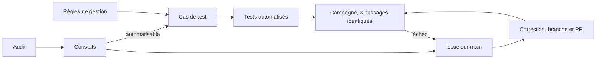

# Plan de tests et plan d'audit du front

Support de la présentation orale. Ce document explique **quels tests et quels audits sont menés sur LL Studio, pourquoi, avec quels outils et selon quel calendrier**. Il résume des documents plus détaillés, rangés sur la branche `tests` :

- [Règles de gestion](https://github.com/underfr/ll-studio/blob/tests/docs/tests/01-regles-de-gestion.md) : ce que l'application doit faire, règle par règle ;
- [Plan de tests](https://github.com/underfr/ll-studio/blob/tests/docs/tests/02-plan-de-tests.md) : les 155 cas de test, un par un ;
- [Exécution](https://github.com/underfr/ll-studio/blob/tests/docs/tests/03-execution.md) : comment lancer les suites et le bilan de chaque campagne.

Il répond à la compétence « Préparer et exécuter les plans de tests d'une application » du titre Concepteur Développeur d'Applications.

## 1. Deux façons complémentaires de vérifier la qualité

| | Tests | Audits |
|---|---|---|
| Question posée | L'application fait-elle ce que disent les règles ? | L'application est-elle accessible, rapide, trouvable, sûre, conforme ? |
| Point de départ | Les règles de gestion | Des référentiels externes : WCAG et RGAA, Core Web Vitals, OWASP, RGPD |
| Forme | Du code qui vérifie un comportement, exécuté à chaque changement | Une mesure à un moment donné, outillée et manuelle, qui produit des constats |
| Résultat | Vert ou rouge | Des constats classés par gravité, transformés en issues |
| Fréquence | À chaque synchronisation, puis à chaque envoi avec la CI | À des jalons : nouvel écran, avant la mise en production |

Un test ne dira jamais qu'un texte doré est illisible sur une photo claire, et un audit ne vérifie pas qu'une photo masquée reste invisible à un visiteur anonyme. Les deux démarches se nourrissent : un constat d'audit qui peut s'automatiser devient un test, pour ne plus régresser.

# Partie A : le plan de tests

## 2. Tester des règles, pas du code

Avant d'écrire le moindre test, l'API et le front ont été relus pour en extraire **128 règles de gestion établies**, par exemple « une photo masquée n'est visible que de l'administrateur et de son auteur » ou « la connexion est verrouillée 15 minutes après 5 échecs ». **12 points restent à trancher** (RG-Q), quand le code et la documentation se contredisaient ou que le comportement n'était pas décidé.

Pourquoi partir des règles :

- un test qui vérifie une règle reste valable si le code est réécrit ;
- chaque cas de test cite les règles qu'il vérifie : un script contrôle qu'**aucune règle n'est oubliée** et qu'aucun test ne porte un identifiant inconnu ;
- les points à trancher sont visibles au lieu d'être figés par un test écrit au hasard du comportement actuel.

## 3. Cinq niveaux de test, chacun pour une raison

| Niveau | Outil | Ce qu'il prouve | Pourquoi ce niveau | Cas | Tests |
|---|---|---|---|---|---|
| Unitaire back | PHPUnit | une classe seule se comporte bien : voter, filtre de visibilité, écouteur de connexion | rapide et précis : en cas d'échec, la classe fautive est connue | 15 | 34 |
| Fonctionnel API | PHPUnit, ApiTestCase, Foundry | une vraie requête HTTP traverse Symfony, la sécurité et la base | la visibilité et les droits n'existent qu'au cours d'une requête : testés plus bas, ils passeraient à tort | 71 | 212 |
| Unitaire front | Vitest | fonctions et composables : session, retour après connexion, construction des requêtes | la logique de session est critique et se teste sans navigateur | 17 | 60 |
| Composant front | Vitest, Nuxt Test Utils, happy-dom | un composant monté réagit comme prévu : visionneuse, menu, formulaire de connexion | vérifie l'interface sans lancer toute l'application, API simulée | 33 | 53 |
| Bout en bout | Cypress, Testing Library | le parcours d'un visiteur dans un vrai navigateur, sur l'application complète | seul niveau qui voit le rendu réel : focus, défilement bloqué, redirections | 19 | 19 |
| **Total** | | | | **155** | **378** |

C'est la pyramide des tests : beaucoup de tests rapides en bas, peu de tests lents en haut. Les 19 parcours Cypress prennent 20 secondes, les 246 tests PHP moins d'une minute, les 113 tests Vitest 3 secondes.

Deux choix d'écriture côté Cypress, qui servent aussi l'accessibilité :

- les éléments sont trouvés **par leur rôle et leur intitulé** (« le bouton Fermer le menu »), jamais par une classe CSS. Si un bouton perd son nom accessible, le test échoue ;
- aucune attente fixe : on attend une requête ou un élément, ce qui évite les tests instables.

## 4. Priorités

| Priorité | Contenu | Pourquoi |
|---|---|---|
| **P0** | Visibilité du contenu masqué, authentification, droits, session du back-office | Une faille ici expose du contenu non publié ou ouvre le back-office |
| **P1** | Règles fonctionnelles : envoi de photos, séries, filtres, galerie, visionneuse | Le cœur du service rendu au visiteur et à la photographe |
| **P2** | Confort : libellés, ordre d'affichage, préchargement | Gênant s'il régresse, sans risque |

Les cas P0 ont été écrits en premier. Exemple : la matrice des droits joue **chaque opération de l'API pour chaque profil** (anonyme, compte simple, propriétaire, administrateur) et vérifie le code de réponse attendu, soit 28 opérations.

## 5. Environnement et données

| Choix | Pourquoi |
|---|---|
| Tout tourne dans la pile Docker du projet, base de test `llstudio_test` séparée | Les tests ne touchent jamais aux données de développement ; un garde-fou refuse de lancer PHPUnit hors environnement de test |
| Chaque test PHP fabrique ses propres données (Foundry) sur une base remise à zéro | Aucun test ne dépend d'un autre ni de l'ordre d'exécution |
| Le front est testé avec une API simulée | Un test front qui échoue désigne le front, pas le réseau |
| Cypress rejoue un jeu de référence connu : 12 photos dont 2 masquées, 2 séries, 7 catégories | Les attendus sont stables et lisibles (« 10 photographies ») |
| Le compteur de tentatives de connexion est remis à zéro avant chaque campagne | Un test ne doit pas échouer parce qu'un autre a provoqué des échecs avant lui |

## 6. Organisation : la branche `tests`

Les tests vivent sur une branche `tests` qui **n'est jamais fusionnée dans `main`**. Elle est mise à jour après chaque évolution de `main` par fusion, jamais par rebase, puisqu'elle est publiée. Elle n'ajoute que des tests et leur configuration.

- **Si un test révèle un défaut, on corrige sur `main`** par une issue, une branche et une pull request, puis on resynchronise. On n'assouplit jamais un test pour le faire passer.
- **Contrepartie assumée** : ces tests ne protègent `main` que s'ils sont exécutés après chaque synchronisation. C'est fait à la main aujourd'hui, et la CI (#37) le fera automatiquement.

## 7. Critères pour clore une campagne

- tous les cas P0 passent ;
- **trois exécutions consécutives donnent le même résultat** : un test qui passe une fois sur deux ne prouve rien ;
- chaque règle établie est vérifiée par au moins un cas ;
- les cas liés à un point à trancher sont marqués « en attente », avec leur identifiant RG-Q.

## 8. Vérifier que les tests sont utiles

Des tests verts ne suffisent pas : il faut savoir qu'ils échoueraient si l'application se trompait. Trois mesures :

**Couverture du code PHP** (`pcov`) : 100 % sur la sécurité, la visibilité, les écouteurs et les traitements d'état, **88,5 %** sur l'ensemble du code applicatif.

**Tests par mutation** : un défaut est introduit volontairement dans l'application, sans être commité, et on vérifie qu'un test le détecte. Douze défauts essayés, douze détectés, par exemple :

| Défaut introduit | Détecté par |
|---|---|
| Le cookie de session n'est plus `HttpOnly` | CT-FB-26 |
| Deux requêtes expirées lancent chacune leur rafraîchissement de session | CT-UF-13 |
| La page de connexion accepte de renvoyer vers un site tiers | CT-UF-09, CT-UF-17, CT-CF-53 |
| La visionneuse ne rend plus le focus à la photo d'origine | CT-CF-05 |
| Le panneau du back-office reçoit le focus avant d'être visible | CT-E2E-19 seulement : seul un vrai navigateur le voit |
| `robots.txt` n'exclut plus `/admin` | CT-E2E-15 |

**Traçabilité** : contrôle par script, cas par cas et règle par règle.

## 9. Résultats à ce jour

Campagne du 16 octobre 2026, après la synchronisation avec les correctifs d'accessibilité (#33) :

| Niveau | Tests | Résultat |
|---|---|---|
| PHP, unitaires et fonctionnels | 246 | verts, dont 2 volontairement « incomplets » : ils signalent un point à trancher |
| Front, unitaires et composants | 113 | verts |
| Bout en bout | 19 | verts |
| **Total** | **378** | **les 155 cas du plan sont couverts, trois passages identiques** |

Ce que les tests ont trouvé, et la suite donnée :

| Constat | Suite |
|---|---|
| Supprimer une catégorie encore utilisée provoque une erreur 500 | Point à trancher RG-Q-01, test en attente |
| L'API refuse `Accept: application/json` alors que sa documentation l'annonce | Point à trancher RG-Q-05, test en attente |
| Une visionneuse montée déjà ouverte restait invisible, régression de la migration vers daisyUI | Corrigé sur `main` (#71), sans toucher au test |
| Attributs VichUploader importés depuis un espace de noms déprécié | Corrigé sur `main` (#59) |
| Les tests PHP démarraient en environnement de développement | Corrigé, garde-fou ajouté |
| Un test de tri échouait une fois sur quelques centaines, selon le titre tiré au hasard | Donnée fixée, diagnostic confirmé en rejouant la graine fautive |

## 10. Tests à venir

| Quand | Évolution testée | Tests prévus | Pourquoi |
|---|---|---|---|
| Itération 8, du 27 octobre au 9 novembre | Gestion des photos et envoi d'images (#27, #29), boîte de réception (#42) | règles des écrans de gestion ; composants des formulaires ; parcours Cypress d'envoi d'une image | premiers écrans qui modifient des données : erreurs de validation et droits à vérifier côté interface |
| Itération 9, du 10 au 23 novembre | Séries et catégories (#28), ordre des séries (#30) | composants et parcours ; décision sur RG-Q-01, puis test complété | la suppression d'une catégorie utilisée doit renvoyer une erreur propre |
| Itération 10, du 24 novembre au 7 décembre | Formulaire de contact (#41), états de chargement et d'erreur (#24), mentions légales (#43) | validation côté front, parcours d'envoi d'un message, présence des pages légales | seul formulaire ouvert aux anonymes |
| Itération 12, du 22 décembre au 4 janvier | Référencement (#34) | parcours vérifiant titres, descriptions, Open Graph et plan du site | éviter qu'une évolution casse le référencement en silence |
| Itération 13, du 5 au 18 janvier | Consolidation (#31, #32) | campagne complète, bilan de couverture et de traçabilité | clore les deux issues de tests avec un bilan chiffré |
| Itération 14, du 19 janvier au 1er février | CI (#37) | les trois suites lancées à chaque envoi sur `tests`, plus une vérification axe automatique de chaque page publique dans Cypress | ne plus dépendre d'un lancement manuel ; empêcher les régressions d'accessibilité |
| Itération 15, du 2 au 15 février | Dossier professionnel (#51) | rapport d'exécution final | il sert de jeu d'essai : entrée, résultat attendu, résultat obtenu |

# Partie B : le plan d'audit du front

## 11. Les audits prévus

| Audit | Pourquoi | Outils | Critère de réussite | Quand |
|---|---|---|---|---|
| **Accessibilité** | Un portfolio se lit avec les yeux, mais aussi au clavier, au lecteur d'écran, avec une vue basse ou un écran en plein soleil | axe-core, contrôle manuel au clavier, calcul des contrastes WCAG et APCA, mesure des textes sur photo, lecteur d'écran | aucune violation WCAG 2.1 A et AA ; contrastes 4,5:1 pour le texte, 3:1 pour les composants | **Fait le 16 octobre (#33)**, puis à chaque nouvel écran |
| **Performance** | Un site de photographe est lourd par nature ; les visiteurs viennent souvent d'un téléphone ; la lenteur fait fuir et pèse sur le référencement | Lighthouse en mode mobile, PageSpeed Insights sur le site déployé, onglet réseau | Lighthouse performance au moins 90 ; LCP sous 2,5 s, CLS sous 0,1, INP sous 200 ms (seuils « bons » de Google) | avant et après l'optimisation des images (#23, itération 11), puis audit complet (#35, itération 14) |
| **Référencement** | Un portfolio doit être trouvé par des clients ; un lien partagé doit afficher un bel aperçu | Lighthouse SEO, validateur Open Graph, Google Search Console après déploiement | Lighthouse SEO à 100 ; titre et description uniques par page ; image d'aperçu ; plan du site complet ; back-office exclu | itération 12 (#34), puis après déploiement |
| **Sécurité côté front** | Le site a un back-office protégé par une session ; les dépendances JavaScript et PHP évoluent sans cesse | `pnpm audit`, `composer audit`, Mozilla HTTP Observatory, relecture selon l'OWASP Top 10 | aucune vulnérabilité connue de gravité haute ; en-têtes de sécurité HTTP présents en production ; aucun jeton lisible par JavaScript | à chaque itération pour les dépendances ; avec le déploiement de production (#36, #38) pour les en-têtes |
| **RGPD et mentions légales** | Le formulaire de contact collecte un nom, une adresse et un message : ce sont des données personnelles ; un site professionnel doit publier ses mentions légales | liste de contrôle CNIL, outils du navigateur pour lister cookies et requêtes vers des tiers | mentions légales et politique de confidentialité accessibles depuis chaque page ; durée de conservation des messages fixée ; aucun cookie non essentiel ni traceur tiers | itération 10 (#43) |
| **Qualité du code** | Repérer les erreurs avant l'exécution et garder un code homogène, lisible par un autre développeur | ESLint, vérification des types (vue-tsc), PHPStan, PHP-CS-Fixer | zéro erreur ; niveau PHPStan fixé au premier passage, sans régression ensuite | itération 11 (#48), puis dans la CI (#37) |
| **Compatibilité et adaptation aux écrans** | Les visiteurs utilisent Safari sur iPhone autant que Chrome sur ordinateur ; certains composants s'appuient sur des fonctions récentes du navigateur | parcours principaux joués à la main sur Safari iOS, Chrome, Firefox et Edge ; largeurs 375, 600, 900 et 1280 px ; zoom à 200 % | parcours complets sur les deux dernières versions de chaque navigateur ; aucun défilement horizontal à 320 px | itération 14, avant la mise en production |
| **Éco-conception** (complémentaire) | Un site d'images consomme beaucoup de données : alléger profite à la planète, au forfait du visiteur et à la vitesse | EcoIndex, poids et nombre de requêtes relevés avec la performance | poids de l'accueil et note EcoIndex relevés avant et après l'optimisation des images | avec l'audit de performance |

Chaque audit suit la même boucle : mesurer, classer les constats par gravité, ouvrir une issue par lot de corrections sur `main`, corriger, **mesurer à nouveau avec la même méthode**, et transformer en test ce qui peut l'être.

## 12. Pourquoi l'accessibilité en premier

- **Le cadre** : en France, le RGAA, fondé sur les WCAG 2.1 niveau AA, s'impose aux services publics et aux grandes entreprises, et la directive européenne sur l'accessibilité s'applique depuis juin 2025 à de nombreux services en ligne. Un portfolio d'indépendant n'y est pas soumis, mais c'est la référence reconnue de ce qu'est une interface correcte.
- **Le moment** : le site venait d'être restylé avec daisyUI (#67, #68). Auditer juste après une refonte visuelle évite de construire les écrans du back-office sur des couleurs défaillantes.
- **Le signal** : à l'œil, certains textes sur boutons dorés paraissaient peu lisibles. Il fallait le mesurer plutôt que le juger.

## 13. L'audit d'accessibilité réalisé

Détail complet dans #33, corrections dans la pull request #73.

**Méthode**

1. axe-core sur toutes les pages publiques et la page de connexion, règles WCAG 2.0 à 2.2 niveaux A et AA ;
2. calcul des contrastes de chaque couple de couleurs du thème, états de survol et de focus compris, selon deux modèles : **WCAG 2**, la norme actuelle, et **APCA**, le modèle perceptif étudié pour la future version 3 ;
3. **mesure des textes posés sur les photos**, qu'aucun outil automatique ne sait évaluer : pour chaque bloc et chaque taille d'écran, contraste calculé pixel par pixel sur les 12 photos de démonstration, voile sombre compris ;
4. contrôle au clavier : anneau de focus, piège du focus dans les panneaux, lien d'évitement ;
5. comparaison du thème avec les 35 thèmes fournis par daisyUI.

**Constats principaux et corrections**

| Constat | Avant | Après |
|---|---|---|
| Textes sur photo : en-têtes de l'accueil et des séries, légendes des tuiles | 87 échecs sur 12 photos et 9 dispositions | **0** |
| Texte des boutons principaux, or vif et encre | 7,9:1 en WCAG 2 mais **Lc 56 en APCA**, sous le seuil d'un libellé | or profond et crème : 5,7:1 et **Lc 80** |
| Anneau de focus des boutons sur fond crème | 2,2:1 | 5,7:1 |
| Contour des champs de formulaire | 1,55:1 | 3,5:1 |
| Bandeau défilant des catégories | 3,5:1, défilement impossible à arrêter (critère 2.2.2) | 6,9:1, bouton pause |
| Violations relevées par axe | 2 types : contraste, repère mal placé | **aucune** |

**Ce que l'audit enseigne**

- **Un outil automatique ne suffit pas** : axe ne voyait ni le texte illisible sur une photo claire, ni le défaut du contour des champs. Les échecs les plus graves ont été trouvés par la mesure sur photos.
- **Respecter la norme ne garantit pas la lisibilité** : le bouton doré passait largement la norme WCAG 2 tout en restant difficile à lire. APCA a expliqué la gêne : un or de luminosité moyenne ne contraste vraiment ni avec le noir ni avec le blanc.
- **Changer de thème n'était pas la solution** : les thèmes daisyUI proches de la charte échouaient tous sur au moins un couple de couleurs. La correction a consisté à redistribuer les rôles des deux ors existants, sans couleur nouvelle.

**Limites et suite**

- Les pages du back-office ne sont pas encore auditées avec une session ouverte : elles le seront avec les écrans de gestion (itérations 8 et 9).
- Restent à faire : un passage au lecteur d'écran (VoiceOver), le zoom à 200 % et l'affichage à 320 px de large, la vérification axe automatique dans Cypress (itération 14), et la mise à jour de la maquette Figma (#66).

## 14. Calendrier d'ensemble

| Itération | Dates | Tests | Audits |
|---|---|---|---|
| 7 | du 13 au 26 octobre | synchronisation après daisyUI et #33 : 378 tests verts | **accessibilité (#33)**, fait |
| 8 | du 27 octobre au 9 novembre | gestion des photos, envoi d'images, boîte de réception | accessibilité des nouveaux écrans ; dépendances |
| 9 | du 10 au 23 novembre | séries, catégories, ordre | accessibilité des nouveaux écrans ; dépendances |
| 10 | du 24 novembre au 7 décembre | formulaire de contact, états, pages légales | **RGPD et mentions légales** |
| 11 | du 8 au 21 décembre | non-régression | **qualité du code** (#48) ; première mesure de performance avant et après les images (#23) |
| 12 | du 22 décembre au 4 janvier | référencement | **référencement** (#34) |
| 13 | du 5 au 18 janvier | consolidation, clôture de #31 et #32 | |
| 14 | du 19 janvier au 1er février | CI, axe automatique | **performance** (#35), **compatibilité**, éco-conception |
| 15 | du 2 au 15 février | rapport final, jeu d'essai (#51) | **sécurité** du site déployé (#38) ; contre-audit d'accessibilité complet |
| Soutenance | 31 mars 2027 | | |

## 15. Fil proposé pour l'oral

1. **Le constat de départ** : une application qui protège du contenu et un back-office, qu'il faut pouvoir faire évoluer sans tout revérifier à la main.
2. **La démarche** : des règles de gestion aux cas de test, cinq niveaux, priorités P0 à P2 (sections 2 à 4).
3. **Démonstration** : lancer les parcours Cypress (20 secondes), puis montrer un test par mutation, défaut introduit et test qui passe au rouge.
4. **Les résultats** : 378 tests, 155 cas, 128 règles couvertes, et ce que les tests ont trouvé (section 9).
5. **L'audit d'accessibilité** : méthode, avant et après sur une photo claire, et l'enseignement « respecter la norme ne suffit pas » (section 13).
6. **La suite** : calendrier des tests et des audits jusqu'à la mise en production (section 14).

## Glossaire

| Terme | Sens |
|---|---|
| WCAG | Règles internationales d'accessibilité du web, du W3C. Niveau AA : le niveau visé habituellement |
| RGAA | Référentiel français d'accessibilité, fondé sur les WCAG |
| APCA | Méthode de calcul du contraste fondée sur la perception, étudiée pour les WCAG 3. Résultat noté Lc |
| LCP, CLS, INP | Indicateurs de Google : temps d'affichage du plus grand élément, stabilité de la mise en page, réactivité aux actions |
| Test par mutation | Introduire volontairement un défaut pour vérifier qu'un test le détecte |
| Fixtures | Jeu de données de démonstration chargé dans la base |
| OWASP Top 10 | Liste de référence des dix risques de sécurité les plus courants des applications web |
